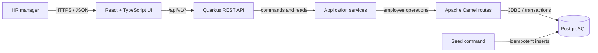

# Architecture and Design Notes

**Stack versions:** Quarkus 3.40.1 / Camel Quarkus 3.40.0 extension stream, Java 21, PostgreSQL 17, React 19, Vite 8. The compatible Quarkus and Camel platform BOMs are imported together. Confirm and update versions as a matched release set when upgrading.

## System view

The application is a **modular monolith**: one Quarkus deployable, one PostgreSQL database, and one separately built React application. This is deliberately simpler than microservices for one HR workflow and 10,000 employees. Camel is used as an explicit integration/orchestration boundary for employee queries and salary changes; it does not replace the domain service, REST API, or database.

## Responsibilities and request flow

1. **React UI** owns presentation, query/filter state, and user feedback. It calls the versioned API and does not access PostgreSQL.
2. **Quarkus REST resources** validate HTTP input and produce stable JSON responses and status codes.
3. **Application/domain services** enforce salary rules and coordinate the use cases. Salary must be non-negative, currency must be a supported three-letter code, and a no-op edit does not create a history event.
4. **Camel routes** dispatch typed employee search, summary, detail, and salary-change commands to application handlers. Camel is useful here as the required integration layer and leaves an extension point for future payroll/HRIS adapters; for this small release it is intentionally not used as a distributed message broker.
5. **PostgreSQL** is the source of truth. Database constraints provide a second line of defense. A salary update and its audit row commit atomically.

## Data model

- `employee`: UUID primary key; unique employee number; first/last name; email; department; country code; currency code; annual base salary `NUMERIC(14,2)`; created/updated timestamps.
- `salary_change`: UUID primary key; employee foreign key; previous and new annual amounts; currency; change timestamp; actor label. In this demo actor is `demo-hr`; production must derive it from authenticated identity.
- Indexes: unique employee number and email; `(country_code, department)` for common filters; employee foreign key and change timestamp for history lookup. Use parameterized queries only.

Money is stored as decimal, never binary floating point. A salary summary groups by currency; summing USD and EUR into one number would be misleading without a defined FX source and effective date.

## API outline

- `GET /api/v1/employees?query=&country=&department=&page=0&size=25` — paged result and total count.
- `GET /api/v1/employees/{id}` — employee details.
- `GET /api/v1/employees/{id}/salary-history` — salary audit history.
- `PUT /api/v1/employees/{id}/salary` — validate and atomically update annual salary/currency.
- `GET /api/v1/summary` — headcount and salary aggregates grouped by currency.
- `GET /api/v1/metadata` — filter options for the UI.

Error responses should be actionable and must not expose stack traces or SQL. Pagination limits the maximum size to protect the service.

## Scale and performance

10,000 employee rows are modest for PostgreSQL. Use server-side pagination, indexed filters, bounded page size, parameterized queries, and aggregate SQL rather than downloading the full population into the browser. Do not add caching or a search cluster without evidence they are needed. A future performance check should measure seeded search/filter/summary response time and query plans on representative hardware.

## Reliability, security, and operations

- PostgreSQL migrations are version-controlled; schema changes are reproducible.
- Salary and audit history are written in one transaction.
- Health/readiness endpoints and structured logs support local diagnostics.
- CORS is restricted to the local UI origin in development and must be explicitly configured for deployment.
- Demo is unauthenticated and synthetic-data-only. Before production: SSO, role-based authorization, CSRF/rate controls as appropriate, secret management, TLS, audit actor identity, retention policy, backups, monitoring, and privacy/security review are mandatory.

## Trade-offs and alternatives

- **Modular monolith over microservices:** avoids network/distributed-transaction complexity; independently split a service only when ownership or load requires it.
- **PostgreSQL over embedded DB:** matches the requested relational production-like setup and allows realistic indexes/transactions; Docker Compose makes local use accessible.
- **Camel direct routes over a queue:** meets integration requirement while preserving synchronous UI feedback. A broker is unnecessary for interactive reads and a simple salary edit.
- **Currency-grouped totals over one grand total:** preserves financial meaning in a multinational organization without inventing exchange-rate policy.
- **Offset pagination initially:** simple for HR table navigation at 10,000 records. Consider keyset pagination if measured deep-page latency becomes material.
